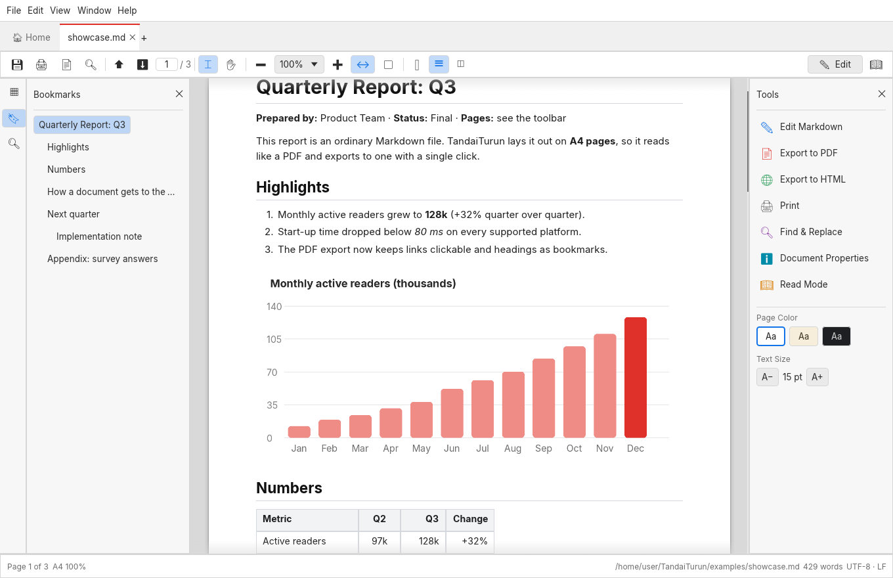
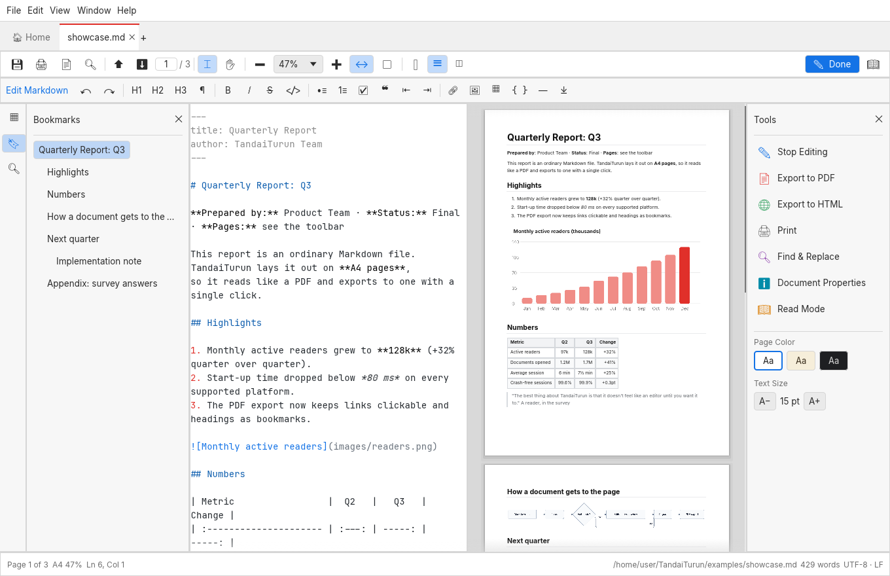
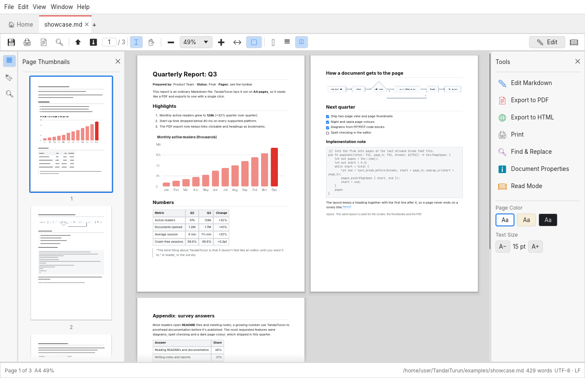
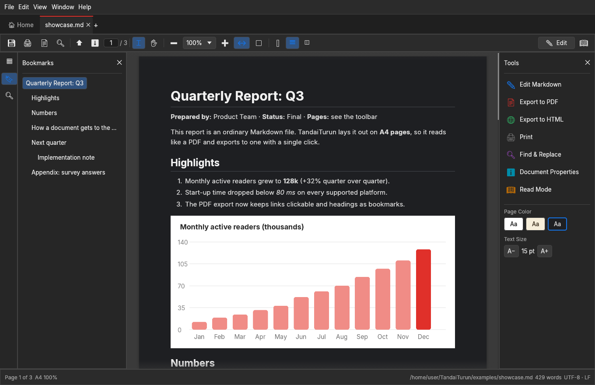
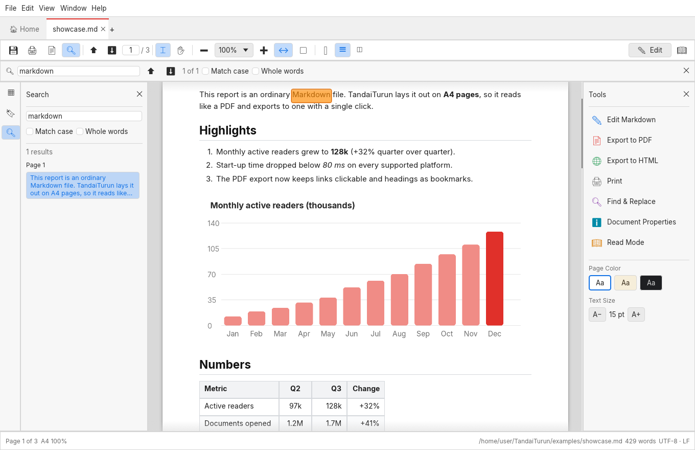
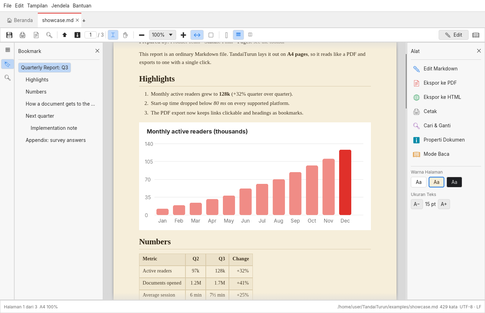

<p align="center">
  
</p>

<h1 align="center">TandaiTurun</h1>

<p align="center">
  Baca Markdown seperti PDF. Edit seperti teks.<br>
  Pembaca dan editor Markdown native dan open source, ditulis dengan Rust.
</p>

<p align="center">
  <a href="https://github.com/sansob/TandaiTurun/actions/workflows/ci.yml"></a>
  <a href="https://github.com/sansob/TandaiTurun/releases"></a>
  
</p>

<p align="center">
  <a href="README.md">English</a> · <b>Bahasa Indonesia</b>
</p>



## Kenapa ada aplikasi ini

Sekarang banyak dari kita menulis dengan Markdown: README, notulen rapat,
laporan, dokumentasi. Tapi untuk *membacanya*, pilihannya melihat teks mentah,
atau membukanya di tab browser atau editor yang menampilkannya sebagai satu
halaman web panjang tanpa ujung. Begitu ada yang minta "PDF-nya", kita sibuk
mencari konverter.

TandaiTurun memperlakukan file Markdown sebagai dokumen. Isinya disusun di
halaman sungguhan (A4 atau Letter) dengan tampilan yang sudah akrab dari PDF
reader: thumbnail halaman, bookmark, kotak zoom, tampilan dua halaman. Kalau mau
mengubah sesuatu, tekan **Edit**: sumbernya terbuka dengan pratinjau langsung.
Setelah itu halaman yang persis sama bisa diekspor ke PDF.

Ini aplikasi native (satu binary ~28 MB, tanpa Electron, tanpa mesin browser),
langsung terbuka, dan tidak pernah mengirim apa pun ke mana pun.

Namanya terjemahan harfiah: *tandai* = "mark", *turun* = "down". Mark down.

## Yang bisa dilakukan

**Membaca**
- Halaman dengan paginasi sungguhan: judul tetap bersama teks sesudahnya, tabel
  dan kode terpotong rapi di antara baris, dan `<!-- pagebreak -->` memulai halaman baru.
- Tampilan bergulir, satu halaman dan dua halaman. Zoom 25 sampai 400 %, pas
  lebar, pas halaman, `Ctrl` + roda mouse.
- **Thumbnail Halaman** dan **Bookmark** (judul-judul) di panel navigasi, dengan
  bagian yang sedang dibaca ditandai saat menggulir.
- **Cari** (`Ctrl+F`) menandai semua hasil di halaman; panel Cari menampilkannya
  per halaman beserta konteksnya. Opsi huruf besar/kecil dan kata utuh.
- Pilih dan salin teks langsung dari halaman, atau geser dengan Alat Tangan.
- Tautan berfungsi: tautan web terbuka di browser, tautan `#bagian` melompat di
  dalam dokumen, tautan ke file `.md` lain membukanya di tab baru.
- **Mode Baca** (`Ctrl+H`) dan layar penuh (`F11`).
- Warna halaman kertas, sepia dan malam; huruf sans (Inter) atau serif; ukuran bisa diatur.

**Dukungan Markdown**
- CommonMark plus ekstensi GitHub: tabel (dengan perataan), daftar tugas,
  coret, catatan kaki, autolink `<https://…>`, ID judul.
- Pewarnaan sintaks blok kode untuk banyak bahasa.
- **Diagram Mermaid** dari blok ```` ```mermaid ````: flowchart, sequence,
  class, state, ER, pie, Gantt, timeline, mindmap dan lainnya, digambar native
  dengan [mermaid-rs-renderer](https://github.com/1jehuang/mermaid-rs-renderer), tanpa browser.
- Gambar di sebelah dokumen (PNG, JPEG, GIF, WebP, BMP, SVG), dan HTML sederhana
  seperti ``, `<br>`, `<mark>`, `<sub>`, `<sup>`.
- Front matter YAML disembunyikan dari halaman dan tampil di Properti Dokumen.

**Mengedit**



- Editor sumber dengan pewarnaan Markdown di sebelah pratinjau berhalaman yang
  mengikuti kursor.
- Toolbar format dan pintasan: judul (`Ctrl+Alt+1…6`), tebal (`Ctrl+B`), miring
  (`Ctrl+I`), coret, kode, daftar, daftar tugas, kutipan, tautan (`Ctrl+K`),
  gambar, tabel, blok kode, garis dan pemisah halaman.
- `Enter` melanjutkan daftar (poin, angka, kotak centang, kutipan); `Tab` dan
  `Shift+Tab` mengatur indentasinya.
- Cari dan ganti di sumber, undo dan redo.
- Menyimpan mempertahankan akhir baris file (LF atau CRLF) dan BOM-nya, lewat
  file sementara, jadi crash tidak pernah meninggalkan dokumen setengah jadi.
- File yang diubah program lain dimuat ulang (atau kamu ditanya, kalau ada
  perubahan yang belum disimpan).

**Ekspor dan cetak**
- **PDF** dengan teks asli yang bisa dipilih (huruf ikut disematkan dan di-subset,
  jadi file tetap kecil), tautan yang bisa diklik, dan judul sebagai bookmark PDF.
- **HTML**: satu file mandiri, gaya ada di dalamnya, tanpa script.
- **Cetak** membuka PDF di penampil PDF sistem, lalu cetak dari sana.
- Ekspor yang sama dari command line, lihat di bawah.

**Dan juga**
- Tab, layar Beranda dengan file terbaru, seret-lepas file, membuka lagi
  dokumen dari sesi terakhir.
- Jadikan TandaiTurun aplikasi bawaan untuk file `.md` dari Preferensi atau
  Beranda (di Windows ini membuka Settings → Default apps untuk kamu pilih:
  Windows tidak mengizinkan aplikasi mengganti bawaannya sendiri).
- Properti Dokumen: jumlah kata, karakter, waktu baca, judul, tautan, gambar…
- **Bantuan → Tentang → Pustaka** menampilkan semua pustaka open source di
  dalam aplikasi, lengkap dengan versi dan lisensinya.
- Bahasa Inggris dan Bahasa Indonesia.
- Tema terang dan gelap.

| | |
|---|---|
|  |  |
|  |  |

## Instalasi

Unduh versi terbaru dari
[halaman Releases](https://github.com/sansob/TandaiTurun/releases):

| Platform | File |
|---|---|
| Windows 10/11 | `TandaiTurun-…-windows-x64-setup.exe` (atau `arm64`), atau `.zip` portable |
| macOS 11+ (Apple Silicon dan Intel) | `TandaiTurun-…-macos-universal.dmg` |
| Debian, Ubuntu | `tandaiturun_…_amd64.deb` (atau `arm64`) |
| Fedora, RHEL, openSUSE | `tandaiturun-….x86_64.rpm` (atau `aarch64`) |
| Linux apa saja | `TandaiTurun-…-x86_64.AppImage`, atau `.tar.gz` |

Build-nya belum ditandatangani (code signing). Di macOS, klik kanan aplikasi
lalu pilih **Open** untuk pertama kali; di Windows pilih **More info → Run anyway**.

### Build dari source

Butuh [Rust](https://rustup.rs) 1.95 atau lebih baru.

```sh
git clone https://github.com/sansob/TandaiTurun
cd TandaiTurun
cargo run --release
```

Di Linux aplikasi memakai library OpenGL/EGL, xkbcommon dan X11 atau Wayland
milik sistem; semua desktop sudah punya. Untuk build mungkin perlu header
development: `sudo apt install libxkbcommon-dev libwayland-dev libxcb-render0-dev libxcb-shape0-dev libxcb-xfixes0-dev`.

## Command line

```sh
tandaiturun catatan.md README.md        # buka dokumen di tab
tandaiturun --export-pdf laporan.md     # → laporan.pdf, tata letak sama dengan aplikasi
tandaiturun --export-html laporan.md hasil.html
tandaiturun --version
```

## Pintasan keyboard

| | |
|---|---|
| `Ctrl+O` / `Ctrl+N` / `Ctrl+S` / `Ctrl+Shift+S` | Buka, baru, simpan, simpan sebagai |
| `Ctrl+W` / `Ctrl+Tab` | Tutup tab, tab berikutnya |
| `Ctrl+E` | Edit Markdown / kembali membaca |
| `Ctrl+F`, `F3`, `Shift+F3` | Cari, berikutnya, sebelumnya |
| `Ctrl+=` / `Ctrl+-` | Perbesar, perkecil |
| `Ctrl+1` / `Ctrl+0` / `Ctrl+2` | Ukuran asli, pas halaman, pas lebar |
| `PgUp` / `PgDn` / `Home` / `End` | Halaman sebelumnya, berikutnya, pertama, terakhir |
| `Ctrl+H` / `F11` | Mode Baca, layar penuh |
| `F4` / `Shift+F4` | Panel navigasi, panel alat |
| `Ctrl+P` / `Ctrl+D` | Cetak, properti dokumen |
| `Ctrl+B` / `Ctrl+I` / `Ctrl+K` / `Ctrl+Alt+1…6` | Tebal, miring, tautan, judul (editor) |

## Privasi

TandaiTurun tidak membuat permintaan jaringan sama sekali. Gambar dari internet
tidak dimuat (jadi dokumen tidak bisa dipakai untuk tahu bahwa kamu membukanya),
tidak ada telemetri, tidak ada akun. Pengaturan disimpan di folder data aplikasi
yang biasa dipakai sistemmu.

## Perlu diketahui

- Matematika (`$…$`) ditampilkan apa adanya, belum di-typeset.
- Render Mermaid berasal dari proyek yang masih muda: kebanyakan diagram tampil
  benar, beberapa tata letak berbeda dari mermaid.js. Diagram yang gagal digambar
  ditampilkan sebagai kode dengan pesan error di atasnya.
- Gambar dari internet tampil sebagai kotak berisi alamatnya.

## Struktur proyek

```
crates/tandaiturun-core   file, outline, pencarian, perintah edit, statistik, ekspor HTML (tanpa GUI)
crates/tandaiturun        aplikasinya: Markdown → halaman, viewer, editor, ekspor PDF, UI
examples/                 panduan awal, contekan dan contoh laporan
packaging/                .deb, .rpm, AppImage, installer Windows, .dmg macOS
```

## Berkontribusi

Laporan bug, ide, terjemahan dan kode sangat diterima: lihat
[CONTRIBUTING.md](CONTRIBUTING.md). Masalah keamanan mohon dilaporkan secara
privat ([SECURITY.md](SECURITY.md)).

## Lisensi

TandaiTurun berlisensi ganda [MIT](LICENSE-MIT) atau
[Apache-2.0](LICENSE-APACHE), silakan pilih. Huruf yang disertakan (Inter,
Liberation Serif, JetBrains Mono, Noto Emoji, Noto Sans Symbols 2, Noto Sans Math)
berlisensi SIL Open Font License 1.1; lisensinya ada di [`assets/fonts`](assets/fonts).
