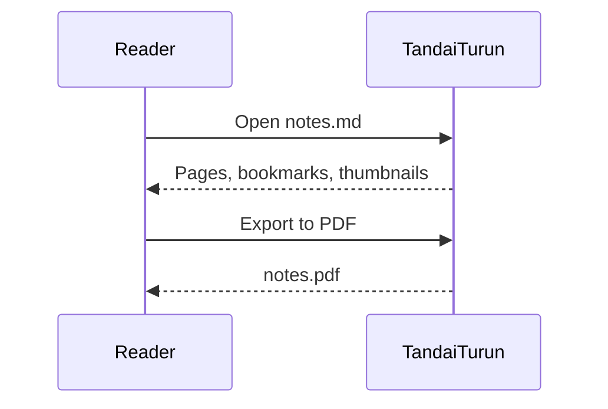

# Markdown Cheat Sheet

Everything below works in TandaiTurun. Press **Edit** to see the source.

## Text

**Bold** with `**bold**`, *italic* with `*italic*`, ~~strikethrough~~ with
`~~strike~~`, `inline code` with backticks, and <mark>highlight</mark> with
`<mark>`. H<sub>2</sub>O and E = mc<sup>2</sup> use `<sub>` and `<sup>`.

A line ending with two spaces or a backslash\
breaks the line without starting a new paragraph.

## Headings

```markdown
# Heading 1
## Heading 2
### Heading 3
```

Headings appear in the **Bookmarks** pane and as PDF bookmarks.

## Lists

- Bullet item
  - Nested item
    - Deeper still
- Another item

1. First
2. Second
3. Third

- [x] Done task
- [ ] Open task

## Links and images

[A link](https://github.com/sansob/TandaiTurun), a link to a
[section of this page](#tables), and an image:

```markdown

```

Images are loaded from your disk, relative to the document.

## Quotes

> Markdown is intended to be as easy-to-read and easy-to-write as is feasible.
>
> > Quotes can be nested.

## Code

```python
def greet(name: str) -> str:
    return f"Halo, {name}!"
```

```json
{ "name": "TandaiTurun", "native": true }
```

## Diagrams

Code blocks marked `mermaid` are drawn as diagrams (flowchart, sequence, class,
state, ER, pie, Gantt, timeline, mindmap and more):



## Tables

| Left | Center | Right |
| :--- | :----: | ----: |
| a    |   b    |     c |
| one  |  two   | three |

## Footnotes

Here is a sentence with a footnote.[^1]

[^1]: And this is the footnote.

## Horizontal rule and page break

---

`<!-- pagebreak -->` on its own line starts a new page.
