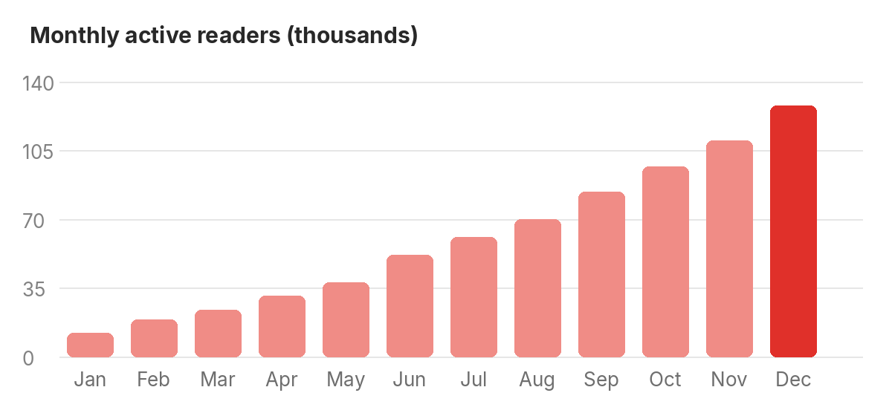
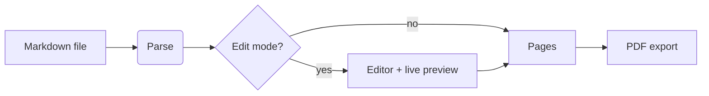

# Quarterly Report: Q3

**Prepared by:** Product Team · **Status:** Final · **Pages:** see the toolbar

This report is an ordinary Markdown file. TandaiTurun lays it out on **A4 pages**,
so it reads like a PDF and exports to one with a single click.

## Highlights

1. Monthly active readers grew to **128k** (+32% quarter over quarter).
2. Start-up time dropped below *80 ms* on every supported platform.
3. The PDF export now keeps links clickable and headings as bookmarks.



## Numbers

| Metric                 |  Q2   |   Q3   | Change |
| :--------------------- | :---: | -----: | -----: |
| Active readers         | 97k   |  128k  |  +32%  |
| Documents opened       | 1.2M  |  1.7M  |  +41%  |
| Average session        | 6 min | 7½ min |  +25%  |
| Crash-free sessions    | 99.6% | 99.9%  | +0.3pt |

> "The best thing about TandaiTurun is that it doesn't feel like an editor
> until you want it to." A reader, in the survey

## How a document gets to the page



## Next quarter

- [x] Ship two-page view and page thumbnails
- [x] Night and sepia page colours
- [x] Diagrams from `mermaid` code blocks
- [ ] Spell checking in the editor

### Implementation note

```rust
/// Cuts the flow into pages at the last allowed break that fits.
pub fn paginate(total: f32, page_h: f32, breaks: &[f32]) -> Vec<PageSpan> {
    let mut pages = Vec::new();
    let mut start = 0.0;
    while start < total {
        let end = last_break_before(breaks, start + page_h).unwrap_or(start + page_h);
        pages.push(PageSpan { start, end });
        start = end;
    }
    pages
}
```

The layout keeps a heading together with the first line after it, so a page
never ends on a lonely title.[^layout]

[^layout]: The same layout is used for the screen, the thumbnails and the PDF.

<!-- pagebreak -->

## Appendix: survey answers

Most readers open **README** files and meeting notes; a growing number use
TandaiTurun to proofread documentation before it's published. The most requested
features were diagrams, spell checking and a dark page colour, which shipped in
this quarter.

| Answer                                  | Share |
| --------------------------------------- | ----: |
| Reading READMEs and documentation       |  46%  |
| Writing notes and reports               |  31%  |
| Proofreading before publishing          |  17%  |
| Something else                          |   6%  |
